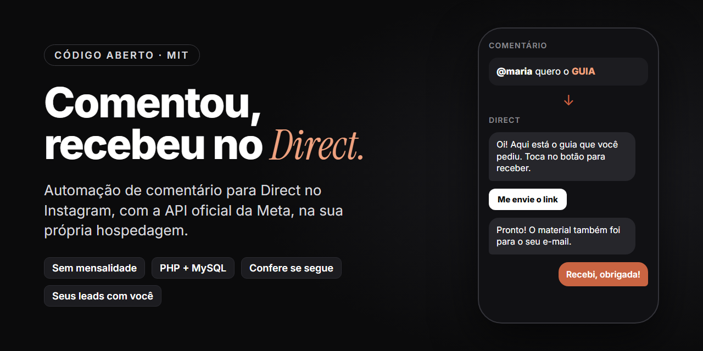

# Instagram Auto Direct



[Português](README.md) · **English**

Someone comments a keyword on your post and gets your material in their DMs, automatically. No monthly tool fee:
it runs on the hosting you already pay for, using Meta's official API.

> **Before you start:** every user creates their own Meta app. Meta's documentation says that receiving comments
> from anyone requires "advanced access", which goes through App Review. In the author's test, publishing the app
> was enough, but this may vary from account to account. If comments from other people do not arrive, you will need
> to request App Review (see [step 9 of the install guide](INSTALACAO.md#9-publicar-o-app), in Portuguese).

## What it does

1. Someone comments a keyword (e.g. GUIDE) on a post.
2. The system replies to the comment ("Sent it to your DMs!") and sends a DM with a button.
3. The person taps the button. The system checks whether they follow you; if not, it asks them to follow first.
4. Followers get a link to a short form (name, email and WhatsApp).
5. Once they fill it in, the material opens, arrives by DM and email, and you get a new lead alert.
6. Anyone who stops halfway gets a single reminder about 24 hours later.

It also includes:

- the same keyword sent straight to the DMs (good for Stories)
- a leads page with spreadsheet export and a "Message on WhatsApp" button
- a funnel per post: how many commented, tapped the button, got the link and filled in the form
- replies to old comments, from before installation
- an English version of the flow for people who comment from abroad
- Facebook Page support through Messenger (optional)
- ready-made privacy policy, terms and data deletion pages, which Meta requires
- automatic data deletion through the DMs
- guided installation with Claude Code

## What you need

| Item | Cost |
|---|---|
| Professional Instagram account (business or creator) | 0 |
| Meta developer account (developers.facebook.com) | 0 |
| Hosting with PHP 8, MySQL and scheduled tasks (cron) | the one you already pay for |
| A subdomain with HTTPS (e.g. `ig.yourdomain.com`) | 0 |
| Email service for the alerts (Brevo, free plan) | 0 |

Tested on PHP 8.1 and 8.4. The first installation takes 1 to 2 hours, mostly in Meta's dashboard.

## Install

**With Claude Code (easiest):** download this repository, open the folder in Claude Code and type:

```
/instalar-auto-direct
```

It asks for your handle, your domain and your keywords, builds your files and guides you through every Meta and
hosting screen. The guide is in Portuguese; you can ask Claude Code to walk you through it in English.

**Without Claude Code:** follow [INSTALACAO.md](INSTALACAO.md), step by step (in Portuguese).

The texts people see (comment reply, DMs, form) are yours to write in `site/regras.php`, in any language.

## This project or a paid tool?

| | Auto Direct (this) | Paid automation tool |
|---|---|---|
| Monthly fee | none | monthly, usually by number of contacts |
| Where it runs | on your hosting | on the company's servers |
| Your leads | in your own database | on their platform |
| Checks follow before sending | yes | depends on the plan |
| Form with email and WhatsApp | yes | depends on the plan |
| Setup | 1 to 2 hours, including Meta's dashboard | minutes, their app is already approved |
| Visual flow builder | no, rules live in a file | yes |

If you do not want to touch hosting or Meta's dashboard, a paid tool is the shorter path.
This project is for people who prefer no monthly fee and keeping their own data.

## Your data stays with you

- Each user creates their **own** Meta app and runs the system on their **own** hosting. Nobody else sees your
  leads, not even the author of this project.
- Passwords live in `site/config.php` and your keywords in `site/regras.php`. Both are in `.gitignore`, so they do
  not get pushed to GitHub if you fork.
- Never paste the contents of `config.php` into any chat, including with Claude. Fill it in directly in the file.

## What Meta's API does not allow

- Messaging someone who only followed you, without interacting.
- Starting a conversation: you can only reply to a comment (once, within 7 days) or to someone who wrote to you
  (within 24 hours).
- Comment-to-DM on TikTok.

## Disclaimer

Independent project, not affiliated with Meta, Instagram or any commercial automation tool.
Use it within the platform's rules. No warranty: Meta changes its API from time to time.

MIT License. Made by [Plinio Ventavoli](https://instagram.com/plinioventavoli).
