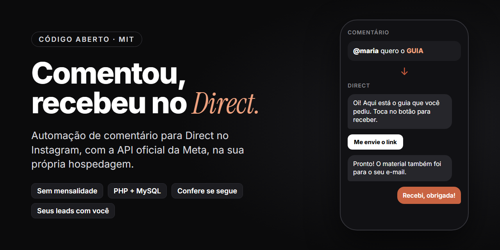

# Auto Direct do Instagram



**[Português](#português)** · **[English](#english)**

## Português

Alguém comenta uma palavra no seu post e recebe o material no Direct, sozinho. Sem mensalidade de ferramenta:
roda na hospedagem que você já tem, com a API oficial da Meta.

> **Antes de começar:** cada pessoa cria o próprio app na Meta. A documentação da Meta diz que receber comentário
> de qualquer pessoa precisa de "acesso avançado", que passa pela análise do app. No teste do autor, só publicar o
> app bastou, mas isso pode variar de conta para conta. Se o comentário de terceiros não chegar, é preciso pedir a
> análise (detalhes no [passo 9 da instalação](INSTALACAO.md#9-publicar-o-app)).

### O que faz

1. A pessoa comenta uma palavra (ex.: GUIA) num post.
2. O sistema responde no comentário ("Te mandei no Direct!") e manda um Direct com um botão.
3. A pessoa toca no botão. O sistema confere se ela segue o perfil; se não segue, pede para seguir.
4. Quem segue recebe o link de um formulário (nome, e-mail e WhatsApp).
5. Preencheu: o material abre, chega no Direct e no e-mail, e você recebe um aviso de lead novo.
6. Quem parou no meio recebe um lembrete único perto de 24 horas depois.

Também tem:

- a mesma palavra mandada direto no Direct (bom para Stories)
- página de leads com planilha e botão "Chamar no WhatsApp"
- funil por post: quantos comentaram, tocaram no botão, receberam o link e preencheram
- resposta a comentários antigos, de antes da instalação
- versão em inglês para quem comenta de fora
- Página do Facebook pelo Messenger (opcional)
- política de privacidade, termos e exclusão de dados prontos, que a Meta exige
- exclusão de dados automática pelo Direct
- instalação guiada pelo Claude Code

### Do que precisa

| Peça | Custo |
|---|---|
| Conta profissional no Instagram (comercial ou criador) | 0 |
| Conta de desenvolvedor na Meta (developers.facebook.com) | 0 |
| Hospedagem com PHP 8, MySQL e tarefas agendadas (cron) | a que você já paga |
| Um subdomínio com HTTPS (ex.: `ig.seudominio.com`) | 0 |
| Serviço de e-mail para os avisos (Brevo, plano gratuito) | 0 |

Testado no PHP 8.1 e 8.4. A primeira instalação leva de 1 a 2 horas, a maior parte no painel da Meta.

### Instalar

**Com o Claude Code (mais fácil):** baixe este repositório, abra a pasta no Claude Code e digite:

```
/instalar-auto-direct
```

Ele pergunta o seu @, o domínio e as palavras, monta os seus arquivos e te guia em cada tela da Meta e da hospedagem.

**Sem o Claude Code:** siga o [INSTALACAO.md](INSTALACAO.md), passo a passo.

### Este projeto ou uma ferramenta paga?

| | Auto Direct (este) | Ferramenta paga de automação |
|---|---|---|
| Mensalidade | nenhuma | cobra por mês, em geral por número de contatos |
| Onde roda | na sua hospedagem | no servidor da empresa |
| Seus leads | no seu banco de dados | na plataforma deles |
| Confere se segue antes de mandar | sim | depende do plano |
| Formulário com e-mail e WhatsApp | sim | depende do plano |
| Instalação | 1 a 2 horas, com painel da Meta | minutos, o app deles já é aprovado |
| Editor visual de fluxo | não, as regras ficam num arquivo | sim |

Se você não quer mexer em hospedagem nem no painel da Meta, uma ferramenta paga é o caminho mais curto.
Este projeto é para quem prefere não ter mensalidade e ficar com os próprios dados.

### Os seus dados ficam com você

- Cada pessoa cria o **próprio** app na Meta e roda o sistema na **própria** hospedagem. Ninguém mais vê os seus leads,
  nem o autor deste projeto.
- As senhas ficam no `site/config.php` e as suas palavras no `site/regras.php`. Os dois estão no `.gitignore`:
  não sobem para o GitHub se você fizer um fork.
- Nunca cole o conteúdo do `config.php` em conversa nenhuma, nem com o Claude. Preencha direto no arquivo.

### O que a API da Meta não deixa

- Mandar mensagem para quem só começou a seguir, sem interagir.
- Começar conversa: só dá para responder a um comentário (uma vez, até 7 dias depois) ou a quem escreveu (até 24 horas).
- Comentário que abre Direct no TikTok.

### Aviso

Projeto independente, sem ligação com a Meta, o Instagram ou qualquer ferramenta comercial de automação.
Use dentro das regras da plataforma. Sem garantia: a Meta muda a API de tempos em tempos.

Licença MIT. Feito por [Plinio Ventavoli](https://instagram.com/plinioventavoli).

---

## English

Someone comments a keyword on your post and gets your material in their DMs, automatically. No monthly tool fee:
it runs on the hosting you already pay for, using Meta's official API.

> **Before you start:** every user creates their own Meta app. Meta's documentation says that receiving comments
> from anyone requires "advanced access", which goes through App Review. In the author's test, publishing the app
> was enough, but this may vary from account to account. If comments from other people do not arrive, you will need
> to request App Review (see [step 9 of the install guide](INSTALACAO.md#9-publicar-o-app), in Portuguese).

### What it does

1. Someone comments a keyword (e.g. GUIDE) on a post.
2. The system replies to the comment ("Sent it to your DMs!") and sends a DM with a button.
3. The person taps the button. The system checks whether they follow you; if not, it asks them to follow first.
4. Followers get a link to a short form (name, email and WhatsApp).
5. Once they fill it in, the material opens, arrives by DM and email, and you get a new lead alert.
6. Anyone who stops halfway gets a single reminder about 24 hours later.

It also includes:

- the same keyword sent straight to the DMs (good for Stories)
- a leads page with spreadsheet export and a "Message on WhatsApp" button
- a funnel per post: how many commented, tapped the button, got the link and filled in the form
- replies to old comments, from before installation
- an English version of the flow for people who comment from abroad
- Facebook Page support through Messenger (optional)
- ready-made privacy policy, terms and data deletion pages, which Meta requires
- automatic data deletion through the DMs
- guided installation with Claude Code

### What you need

| Item | Cost |
|---|---|
| Professional Instagram account (business or creator) | 0 |
| Meta developer account (developers.facebook.com) | 0 |
| Hosting with PHP 8, MySQL and scheduled tasks (cron) | the one you already pay for |
| A subdomain with HTTPS (e.g. `ig.yourdomain.com`) | 0 |
| Email service for the alerts (Brevo, free plan) | 0 |

Tested on PHP 8.1 and 8.4. The first installation takes 1 to 2 hours, mostly in Meta's dashboard.

### Install

**With Claude Code (easiest):** download this repository, open the folder in Claude Code and type:

```
/instalar-auto-direct
```

It asks for your handle, your domain and your keywords, builds your files and guides you through every Meta and
hosting screen. The guide is in Portuguese; you can ask Claude Code to walk you through it in English.

**Without Claude Code:** follow [INSTALACAO.md](INSTALACAO.md), step by step (in Portuguese).

The texts people see (comment reply, DMs, form) are yours to write in `site/regras.php`, in any language.

### This project or a paid tool?

| | Auto Direct (this) | Paid automation tool |
|---|---|---|
| Monthly fee | none | monthly, usually by number of contacts |
| Where it runs | on your hosting | on the company's servers |
| Your leads | in your own database | on their platform |
| Checks follow before sending | yes | depends on the plan |
| Form with email and WhatsApp | yes | depends on the plan |
| Setup | 1 to 2 hours, including Meta's dashboard | minutes, their app is already approved |
| Visual flow builder | no, rules live in a file | yes |

If you do not want to touch hosting or Meta's dashboard, a paid tool is the shorter path.
This project is for people who prefer no monthly fee and keeping their own data.

### Your data stays with you

- Each user creates their **own** Meta app and runs the system on their **own** hosting. Nobody else sees your
  leads, not even the author of this project.
- Passwords live in `site/config.php` and your keywords in `site/regras.php`. Both are in `.gitignore`, so they do
  not get pushed to GitHub if you fork.
- Never paste the contents of `config.php` into any chat, including with Claude. Fill it in directly in the file.

### What Meta's API does not allow

- Messaging someone who only followed you, without interacting.
- Starting a conversation: you can only reply to a comment (once, within 7 days) or to someone who wrote to you
  (within 24 hours).
- Comment-to-DM on TikTok.

### Disclaimer

Independent project, not affiliated with Meta, Instagram or any commercial automation tool.
Use it within the platform's rules. No warranty: Meta changes its API from time to time.

MIT License. Made by [Plinio Ventavoli](https://instagram.com/plinioventavoli).
